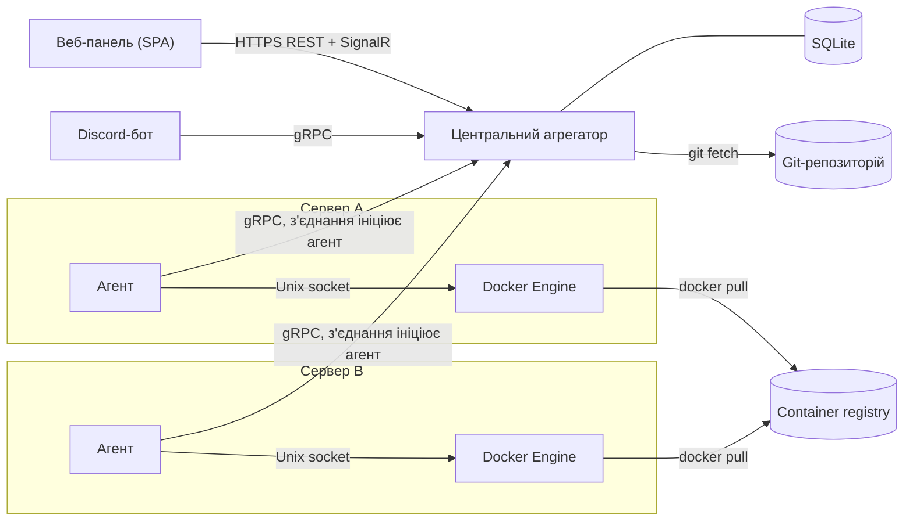
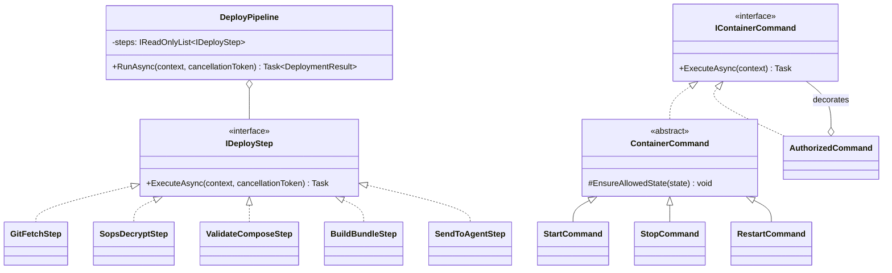

# container-forest — опис навчального проєкту

## Команда

| Учасник | GitHub | Група | Роль |
|---|---|---|---|
| Петренко Богдан Олександрович | [@lepterion](https://github.com/lepterion) | ІПС-22 | Team Lead, System Architect, Security Analyst, Backend Developer (ЦА, агент), DevOps |
| Бояр Володимир Олександрович | [@volodaboyar1-star](https://github.com/volodaboyar1-star) | ІПС-22 | Backend Developer (агент), System Architect |
| Синенко Дмитро Вячеславович | [@Dmyt-S](https://github.com/Dmyt-S) | ІПС-22 | Frontend Developer (Discord-бот) |
| Денисенко Любов Володимирівна | [@denysenkoliubov](https://github.com/denysenkoliubov) | ІПС-22 | Frontend Developer (веб-панель, ЦА), UI/UX Designer |

Ролі затверджено 1 жовтня 2026 року.

Ролі визначають основну відповідальність кожного учасника. Оскільки вимоги лабораторних робіт № 1 і № 2 оцінюються індивідуально, кожен учасник, крім основної ролі, реалізує власні класи на C# і власні екрани веб-панелі, пов'язані з його частиною системи. Тому роль не обмежує, де учасник пише код: екран зараховується тому, хто його реалізував, незалежно від ролі. Розподіл:

| Учасник | Класи на C# (лаба 1) | Екрани веб-панелі (лаба 2) |
|---|---|---|
| Петренко Б. О. | ЦА: пайплайн деплою, робота з SOPS, авторизація | список стеків, редактор стеку, історія деплоїв, ключі середовищ |
| Бояр В. О. | агент: обробники команд, робота з Docker і Docker Compose | середовища та статус агентів, реєстрація агента, контейнери, логи контейнера |
| Синенко Д. В. | Discord-бот, система сповіщень | прив'язка Discord-акаунта, канали сповіщень, правила сповіщень, історія сповіщень |
| Денисенко Л. В. | ЦА: API для веб-панелі, користувачі, аудит | вхід, користувачі, призначення прав, журнал аудиту |

Принцип: у кожного учасника є власні класи на C# і власні екрани веб-панелі. Фактично реалізовані елементи кожен учасник фіксує у файлі `CONTRIBUTIONS.md`; якщо над елементом працювали кілька учасників, він зараховується одному — тому, хто зробив більшу частину або спроєктував його (умова лабораторних № 1 і № 2).

## 1. Коротко про проєкт

**container-forest** — система для керування Docker-контейнерами на кількох серверах через один веб-інтерфейс і Discord-бот. На кожен сервер встановлюється агент, який сам підключається до центрального сервісу і виконує його команди. Конфігурація застосунків зберігається в git-репозиторії, а паролі та інші секрети в ньому зашифровані за допомогою SOPS і розшифровуються лише в центральному сервісі в момент розгортання.

Проєкт орієнтований на невеликі інфраструктури: від одного до кількох серверів, без Kubernetes і Docker Swarm, з невеликою командою, де різні люди мають різний рівень доступу.

## 2. Проблема і мотивація

Типовий спосіб розгорнути застосунок на власному сервері — описати його у файлі `compose.yaml` і запустити через Docker Compose. Поки сервер один і застосунків кілька, цим можна керувати вручну через SSH. Далі виникають проблеми:

- **Керування вимагає доступу до терміналу сервера.** Щоб перезапустити сервіс, який «завис», треба підключитися по SSH і виконати команди. З телефона це незручно, а видавати SSH-доступ кожному учаснику команди небезпечно.
- **Секрети зберігаються у відкритому вигляді.** Паролі до баз даних і токени лежать у `.env`-файлах на сервері або в базі даних панелі керування. Зберігати їх разом із конфігурацією в git не можна.
- **Немає розмежування доступу.** Людині, яка має лише перезапускати один сервіс на одному сервері, доводиться давати або повний доступ, або ніякого.

Найпоширеніший інструмент для цих задач — **Portainer**. У вересні 2026 року його розробники оголосили, що версія 3.x буде орієнтована насамперед на Kubernetes: звичайні Docker-середовища залишаться підтримуваними, але отримуватимуть не всі нові можливості й займатимуть другорядне місце в інтерфейсі; нові функції для GitOps, політик і спостереження розроблятимуться переважно для Kubernetes. Для користувачів «звичайного» Docker це означає поступове відставання інструменту від їхніх потреб. Крім того, Portainer достатньо важкий для невеликої інфраструктури і погано пристосований до роботи з телефона.

Мета проєкту — створити легший інструмент, спеціально розрахований на звичайний Docker, з безпечною роботою із секретами та керуванням через Discord.

## 3. Цільові користувачі та сценарії

- **Адміністратор невеликої інфраструктури** (кілька серверів, особисті проєкти, ігрова спільнота, невелика команда). Хоче бачити стан усіх серверів в одному місці, розгортати застосунки з git-репозиторію і не зберігати секрети у відкритому вигляді.
- **Учасник команди з обмеженим доступом.** Має право лише переглядати стан і перезапускати сервіси на одному конкретному сервері. Не повинен бачити інші сервери чи змінювати конфігурацію.
- **Керування «на ходу».** Сервіс упав увечері, під рукою лише телефон: отримати сповіщення в Discord і перезапустити сервіс командою `/restart` без відкриття ноутбука.

## 4. Основні можливості

### Етап «альфа-версія»

- Центральний сервіс і агент: реєстрація агента за одноразовим токеном, постійне з'єднання, відображення статусу агента (онлайн / офлайн).
- Перегляд контейнерів на кожному сервері, їхнього стану та логів.
- Дії з контейнерами: запуск, зупинка, перезапуск.
- Вхід за логіном і паролем, базове розмежування доступу до середовищ.
- Розгортання стеку з git-репозиторію без зашифрованих секретів.

### Остаточна версія

- Розшифрування секретів SOPS у пайплайні деплою; окрема пара ключів для кожного середовища.
- Розділені операції зі стеками: `restart` (перезапуск процесів), `redeploy` (застосування змін конфігурації), `redeploy with pull` (оновлення образів), `down`.
- Ролі Viewer / Operator / Editor / Admin на рівні середовищ і окремих стеків, журнал аудиту дій.
- Двофакторна автентифікація; вхід через зовнішні провайдери (OIDC, OAuth2).
- Discord-бот: перегляд стану, перезапуск сервісів, сповіщення про падіння контейнерів і результати деплою. Права перевіряються так само, як у веб-панелі.
- Історія деплоїв з прив'язкою до комітів і можливістю відкату.
- Графіки використання ресурсів контейнерами.

### Можливі розширення (за наявності часу)

- Консоль контейнера (exec / attach).
- Дії за розкладом: нічний перезапуск, резервне копіювання томів.
- Сповіщення про вихід нових версій образів.
- Взаємна TLS-автентифікація (mTLS) між агентом і центральним сервісом.

## 5. Архітектура

Система складається з чотирьох застосунків і бази даних:

1. **Центральний агрегатор (ЦА)** — ASP.NET Core; надає REST API і SignalR для веб-панелі та gRPC для агентів і бота; зберігає користувачів, права, історію деплоїв; виконує пайплайн деплою.
2. **Агент** — .NET Worker Service на кожному сервері; підключається до ЦА і керує локальним Docker через Unix socket.
3. **Веб-панель** — односторінковий застосунок (SPA) на React, який працює як окремий сервіс.
4. **Discord-бот** — .NET-застосунок на Discord.Net; спілкується з ЦА через gRPC.
5. **База даних** — SQLite.

### Ключові архітектурні рішення

**Агент сам підключається до центрального сервісу, а не навпаки.** Керувати Docker віддалено можна, відкривши доступ до Docker API по мережі, але це фактично надає root-доступ до сервера кожному, хто зможе туди підключитися. У нашій архітектурі на серверах немає жодних відкритих вхідних портів: агент встановлює вихідне з'єднання до ЦА і отримує команди через нього. Це також дозволяє працювати з серверами за NAT.

**Агент виконує лише фіксований набір команд.** Протокол між ЦА і агентом описаний у форматі Protocol Buffers і містить лише конкретні типізовані операції (перезапустити контейнер, розгорнути стек тощо). Команди «виконай довільну shell-команду» немає.

**Секрети розшифровуються тільки в ЦА.** Приватні ключі для SOPS зберігаються лише в центральному сервісі; агенти отримують уже розшифровані значення безпосередньо перед розгортанням. Для кожного середовища використовується окремий ключ, тому навіть за спільного репозиторію користувач із доступом до одного сервера не може розшифрувати секрети іншого.

**Git-репозиторій отримує ЦА, образи — агент.** ЦА потребує вмісту репозиторію, щоб розшифрувати секрети, тож агенту не потрібні ні ключі, ні доступ до git. Docker-образи агент завантажує напряму з registry: пересилати гігабайти через ЦА немає сенсу.

**Права перевіряються лише в ЦА.** Веб-панель і бот лише приховують недоступні дії; реальна перевірка відбувається в одному місці на сервері, тож обійти обмеження через інший інтерфейс неможливо.

### Пайплайн деплою

Розгортання стеку — це послідовність кроків, кожен з яких реалізований окремим класом:

**ЦА:** отримання змін з git → розшифрування секретів → перевірка образів і compose-файлу → визначення цільового середовища → підготовка облікових даних registry → формування пакета → надсилання агенту.
**Агент:** оновлення файлів стеку й секретів → завантаження образів → `docker compose up`.
**ЦА:** запис результату в історію, сповіщення, пост-деплой дії.

Деплой можна запустити вручну з панелі чи Discord або автоматично — за webhook від GitHub/Gitea після коміту в репозиторій.

## 6. Технології

| Частина | Технології |
|---|---|
| Центральний агрегатор | C#, .NET 10, ASP.NET Core, gRPC, SignalR, EF Core, SQLite |
| Агент | C#, .NET 10 Worker Service, Docker.DotNet, Docker Compose CLI |
| Веб-панель | TypeScript, React, Vite, TanStack Router, TanStack Query |
| Discord-бот | C#, .NET 10, Discord.Net |
| Секрети | SOPS, age |
| Розгортання | Docker, Docker Compose |

## 7. Об'єктно-орієнтований дизайн

Предметна область природно розкладається на об'єкти з поведінкою, тож ООП-підходи застосовуються там, де вони справді потрібні, а не штучно.

| Задача | Підхід |
|---|---|
| Дії з контейнерами і стеками (start, stop, restart, redeploy) | **Command**: кожна дія — окремий клас зі спільним інтерфейсом і власною перевіркою допустимості в поточному стані |
| Перевірка прав доступу | **Decorator** навколо команд: одна перевірка для веб-панелі та бота |
| Пайплайн деплою | **Chain of Responsibility**: кроки реалізують спільний інтерфейс, їх можна додавати без зміни ядра |
| Канали сповіщень (Discord, webhook, журнал) | **Strategy**: спільний інтерфейс `INotifier` |
| Робота з Docker і з агентом | **Adapter**: доменний код працює з абстракцією, а не з конкретною бібліотекою чи протоколом |
| Оновлення стану в реальному часі | **Observer**: події агента поширюються до веб-панелі та бота |
| Обробка команд на агенті | диспетчеризація за типом повідомлення до ієрархії обробників |
| Узагальнені компоненти | generics: `Pipeline<TContext>`, `IRepository<TEntity>`, типізована шина подій |

Фрагмент діаграми класів для двох центральних ієрархій:

## 8. Аналіз аналогів

### Стан на початку розробки (вересень 2026)

| | Portainer CE | Dockge | Komodo | **container-forest** |
|---|---|---|---|---|
| Основний фокус | універсальна панель; з версії 3.x — насамперед Kubernetes | простий менеджер compose-стеків | збірка й розгортання на багатьох серверах | звичайний Docker, кілька серверів, невелика команда |
| Кілька серверів | так | обмежено | так | так |
| Агент ініціює з'єднання | лише в Edge-режимі | ні | так (з версії 2) | так, це єдиний режим |
| Розгортання з git | так | ні | так | так |
| Секрети, зашифровані в git (SOPS) | ні | ні | ні, власне сховище секретів | **так, з окремим ключем на середовище** |
| Ролі та доступ до окремих середовищ | так | ні, один обліковий запис | так | так, включно з окремими стеками |
| Керування через Discord-бот | ні | ні | ні | **так, з тими самими правами** |
| Розділення restart / redeploy / redeploy with pull | ні, одна дія оновлення | частково | так | так |

**Portainer** — найвідоміший і найфункціональніший інструмент, але його розвиток зміщується в бік Kubernetes, він важкий для невеликих інсталяцій і незручний на телефоні.

**Dockge** — легкий і зручний менеджер compose-стеків, однак розрахований на одного користувача і не працює з git та секретами.

**Komodo** — найближчий аналог за архітектурою: у версії 2 він отримав агентів із вихідним з'єднанням, автентифікацію на основі ключів, двофакторний вхід і підтримку OIDC. Це зрілий проєкт з ширшою функціональністю (збірка образів, Docker Swarm, скрипти), і за більшістю можливостей container-forest з ним не конкуруватиме.

**Чим container-forest відрізняється:**

1. **Секрети живуть у git у зашифрованому вигляді.** Уся конфігурація, включно з секретами, версіонується в одному репозиторії; розшифрування відбувається лише в ЦА і з окремим ключем для кожного середовища. В аналогах секрети або зберігаються у відкритому вигляді, або вводяться окремо у власне сховище інструмента.
2. **Discord як повноцінний інтерфейс керування**, а не лише канал сповіщень, з тією самою моделлю прав, що й у веб-панелі.
3. **Свідомо вужчий скоуп**: лише звичайний Docker і compose, без збірки образів на серверах, Swarm чи Kubernetes. Це робить систему простішою у встановленні й розумінні.

**У чому поступаємося:** зрілість, кількість функцій, підтримка Swarm/Kubernetes, збірка образів, розмір спільноти.

### Оновлення за етапами

Аналіз переглядається на кожному етапі проєкту. Зміни додаються окремими підрозділами з датою, а наведений вище стан на початку розробки не редагується, щоб було видно, як змінювалося розуміння аналогів у процесі реалізації.

#### Альфа-версія (жовтень 2026)

**Що змінилося серед аналогів.**

- **Portainer CE зупиняється на 2.x.** Остання версія гілки — 2.45 LTS (кінець серпня 2026); вона отримуватиме виправлення безпеки й помилок, але не нові можливості. Portainer 3.0 виходить як STS-реліз без окремої Community Edition: безкоштовно — лише Business Edition на трьох вузлах (програма «3 Nodes Free»). Звичайний Docker у 3.x працює, але не отримує нових можливостей рушія політик, GitOps і спостереження. На початку розробки ми знали лише про зміщення фокусу на Kubernetes; тепер відкрита версія для Docker фактично заморожена, і користувачі шукають, куди переходити. Це підсилює мотивацію проєкту.
- **Dockge** у версії 1.5.0 отримав підтримку кількох хостів через агентів, тож оцінка «обмежено» в таблиці вище застаріла. Водночас основний репозиторій розвивається повільно (останній коміт — квітень 2026), а нові можливості з'являються у форках.
- **Komodo** активно розвивається (2.3.x, липень–вересень 2026: пагінація API, скасування збірок і запусків) і лишається найближчим аналогом за архітектурою.
- **Arcane** — новий аналог, якого не було в початковому аналізі: відкрита (BSD-3-Clause) панель на Go з агентом, що сам підключається до менеджера (режим Edge), безкоштовними OIDC, MFA і passkeys, сканером вразливостей образів і консоллю контейнера. Ролі в ньому видаються на всю систему, а не на окреме середовище чи стек; шифрування секретів у git і керування з месенджера в документації ми не знайшли.

**Що з'ясувалося під час реалізації.**

- **Сповіщення через живого бота, а не webhook каналу.** Аналоги надсилають сповіщення в Discord webhook'ом, тобто лише текстом. Наш бот тримає потік сповіщень від ЦА, тому під повідомленням можна розмістити кнопки, а натискання виконується з правами того, хто натиснув. Меню `/dashboard` уже дозволяє з Discord вибрати стек і виконати redeploy, redeploy with pull, restart або down, стежачи за деплоєм у тому самому повідомленні.
- **Один вхід для всього.** Панель, REST, агенти й бот працюють через один домен і порт 443 (Caddy з автоматичним сертифікатом, ADR-0005). Агенту на хості не потрібні вхідні порти, а серверу ЦА — окремого порту для тунелів агентів (як порт 8000 для Edge-агентів Portainer).
- **Захист від самовимкнення.** Контейнери самої системи (ЦА, панель, агент) можна лише запускати: зупинка з панелі відрізала б хост від ЦА.
- **Деплой прив'язаний до коміту.** Коміт фіксується до читання файлів, тож навіть деплой, що впав, показує, з якої версії його запускали.
- **Шифрування секретів у git (SOPS), головна відмінність проєкту, ще не реалізоване:** альфа розгортає стеки з публічних репозиторіїв без секретів. Це перше завдання для остаточної версії разом із приватними репозиторіями.

| | Portainer CE 2.45 | Dockge 1.5 | Komodo 2.3 | Arcane | **container-forest (альфа)** |
|---|---|---|---|---|---|
| Розвиток | заморожений, лише виправлення | повільний, форки | активний | активний | навчальний проєкт |
| Кілька серверів | так | так (агенти) | так | так (агенти) | так |
| Агент ініціює з'єднання | лише в Edge-режимі | — | так | так (Edge) | так, єдиний режим |
| Розгортання з git | так | ні | так | частково | так, публічні репозиторії |
| Секрети, зашифровані в git | ні | ні | ні | ні | заплановано (SOPS) |
| Ролі на середовище й окремий стек | на середовище | ні | так | на всю систему | так |
| Керування з Discord | ні | ні | ні | ні | так, команди й меню з тими самими правами |
| Сповіщення з кнопками дій | ні | ні | ні (лише текст) | — | так, про результати деплоїв |
| Розділення restart / redeploy / redeploy with pull / down | ні | частково | так | частково | так |

«—» — даних не знайшли. Оцінки Arcane і «частково» для нього — за оглядами й документацією, без власної перевірки.

## 9. Зв'язок із лабораторними роботами

- **Лабораторна № 1 (базові ідеї ООП).** Класи, ієрархії та поліморфізм реалізуються в серверній частині на C# (розділ 7). Кожен учасник веде облік своїх класів, методів, ієрархій і випадків поліморфізму у файлі `CONTRIBUTIONS.md`.
- **Лабораторна № 2 (графічний інтерфейс).** Реалізується у веб-панелі: екрани середовищ, контейнерів, логів, стеків, історії деплоїв, користувачів і прав, налаштувань сповіщень. Кожен учасник реалізує екрани своєї частини системи (див. розділ «Команда»). Discord-бот до цієї лабораторної не зараховується, тому учасник, відповідальний за бота, також реалізує екрани веб-панелі.
- **Лабораторна № 3 (зовнішні бібліотеки).** Кандидати: Docker.DotNet, Discord.Net, gRPC для .NET, LibGit2Sharp, YamlDotNet, Quartz.NET, TanStack Query, TanStack Router, Monaco Editor, xterm.js. Ретроспективи ведуться в `docs/retro/`.

## 10. Ризики

- **Обсяг.** Система має кілька взаємодіючих компонентів. Щоб зменшити ризик, альфа-версія зосереджена на мінімальному наскрізному сценарії: агент → перегляд контейнерів → перезапуск.
- **Безпека.** Агент має root-доступ до сервера, тож помилка в ЦА критична. Базові правила безпеки зафіксовані в [docs/architecture.md](architecture.md#інваріанти-безпеки) як інваріанти, які перевіряються при рев'ю.
- **Досвід команди.** Не всі учасники раніше працювали з Docker, gRPC та React. Інтерфейси між частинами фіксуються на початку, щоб учасники могли працювати паралельно.
- **Нерівномірний розподіл за лабораторними.** Ролі в команді розподілені за компонентами системи, а вимоги лабораторних оцінюються для кожного учасника окремо. Тому, крім основної ролі, кожен учасник має власну частину коду на C# і власні екрани веб-панелі (розділ «Команда»).
- **Демонстрація.** Для захисту використовується окреме тестове середовище, а не робоча інфраструктура.

## 11. Джерела

- Анонс Portainer 3.0 і його аргументація: https://www.portainer.io/blog/the-docker-api-ceiling
- Огляд змін у Portainer 3.0: https://linuxiac.com/portainer-3-0-goes-kubernetes-first-leaving-docker-secondary/
- Komodo v2.0.0, примітки до випуску: https://komo.do/docs/releases/v2.0.0
- Dockge: https://github.com/louislam/dockge
- Portainer CE лишається на 2.x, 3.0 без Community Edition: https://www.it-connect.tech/portainer-3-0-puts-kubernetes-first-as-ce-stops-at-2-x/
- Альтернативи Portainer після 3.0: https://dev.to/selfhostpilot/portainer-30-drops-the-community-edition-what-self-hosters-should-run-instead-22h8
- Komodo, випуски: https://github.com/moghtech/komodo/releases
- Arcane: https://github.com/getarcaneapp/arcane, огляд — https://computingforgeeks.com/install-arcane-docker-management/
- SOPS: https://github.com/getsops/sops

Технічні деталі реалізації описані в [architecture.md](architecture.md).
